<div align="center">



<br/>

<a href="https://colab.research.google.com/github/Monokhan/Extractor-de-datos-PDF-a-Excel-infomes-de-inspeccion-Doland/blob/main/extractor_de_datos_pdf_a_excel_informes_de_inspeccion_doland.ipynb"></a>


</div>

Automatiza la lectura de **informes de inspección de elementos de izaje** en PDF. En vez de copiar a mano cada campo, el script recorre los informes, extrae los datos clave y los guarda en un Excel listo para limpiar y analizar. Se puede adaptar a cualquier PDF que tenga etiquetas fijas.

## 🔎 Campos que extrae

`Número de Reporte` · `Cliente` · `Faena` · `Área` · `Fecha de Reporte` · `Responsable del Reporte` · `Descripción` · `Código Único del Producto` · `Estado del Producto` · `Comentario` · `Causas` · `Ítem`

Cuando un campo aparece varias veces en una página (por ejemplo, varios ítems), los valores se guardan juntos separados por `;`. Si un campo no aparece, se registra `0`.

## ⚙️ Cómo funciona

```
PDF ──► pdfplumber (texto por página) ──► búsqueda de cada etiqueta ──► fila en Excel (openpyxl)
```

## 🚀 Cómo usarlo

1. Instala las dependencias: `pip install pdfplumber openpyxl`.
2. En `main()`, cambia `folder_path` por tu carpeta y agrega tus informes a la lista `pdf_files`.
3. Ejecuta el notebook. El resultado queda en `datos1.xlsx`, dentro de esa misma carpeta.
4. En Excel, separa los valores múltiples en columnas con `=TRANSPONER(DIVIDIRTEXTO(A2;";"))`.

Para otro tipo de informe, basta con editar la lista `variables` con las etiquetas de tu PDF.

```
├── extractor_de_datos_pdf_a_excel_informes_de_inspeccion_doland.ipynb   ← script
└── assets/                                                              ← banner de este README
```

---

<div align="center">

Hecho por **[Marcelo Reinoso](https://github.com/Monokhan)** · datos aplicados a minería e infraestructura

</div>
